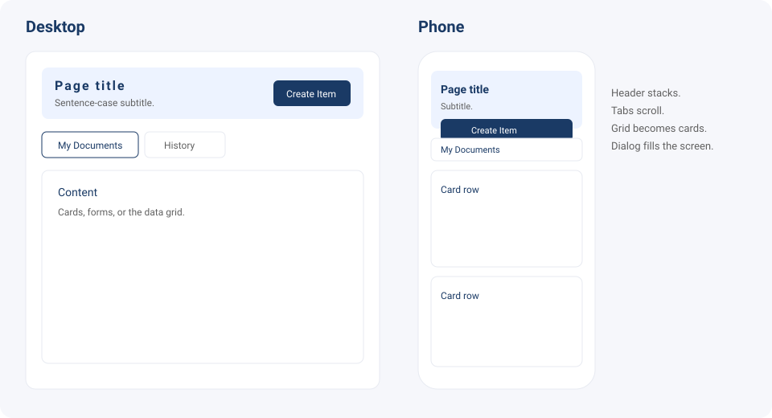

# shared-ui

Shared UI and UX component library for the organization. Every app imports `@shared-ui/react`. A screen does not name a font, paste a brand color, or add a second button, icon, or dialog library.

Every component and icon from this package starts with `X`, so a screen can see that it came from the shared library. The package is one folder per concern, that `X` prefix, and a single `src/index.ts` that re-exports each folder. Sign-in and branding settings are shared screens. Each app still owns the auth request, the file upload, and saving.



A feature screen is a column: page header, optional tabs, then content. On a phone the header stacks, tabs scroll, the data grid becomes one card per row, and a dialog or drawer fills the screen. Touch targets are at least 44 pixels.

## Features

| Area | Exports |
| --- | --- |
| Theme | `XLightTheme`, `XDarkTheme`, `createXTheme`, `XThemeProvider`, `XCssBaseline`, `XThemeTokens`, `XDefaultFont`, `XAllowedFonts`, `XFontFamily` |
| Icons | `XIconChevronLeft`, `XIconChevronRight`, `XIconChevronDown`, `XIconChevronUp`, `XIconClose`, `XIconEdit`, `XIconAdd`, `XIconDelete`, `XIconSearch`, `XIconSettings`, `XIconFilter`, `XIconMenu`, `XIconMore`, `XIconCopy`, `XIconDownload`, `XIconUpload`, `XIconRefresh`, `XIconSave`, `XIconCheck`, `XIconShare`, `XIconExternal`, `XIconShow`, `XIconHide`, `XIconSuccess`, `XIconError`, `XIconWarning`, `XIconInfo`, `XIconHelp`, `XIconPerson`, `XIconDocument`, `XIconRecord`, `XIconOrganization`, `XIconDashboard`, `XIconTask`, `XIconHome`, `XIconMail`, `XIconCalendar`, `XIconBell`, `XIconLock`, `XIconLogout`, `XIconBold` |
| Actions | `XButton`, `XIconButton`, `XBackButton`, `XToggleButton`, `XToggleButtonGroup` |
| Inputs | `XTextField`, `XSelect`, `XMultiSelect`, `XRadioGroup`, `XCheckbox`, `XColorField`, `XFileDropzone`, `applyXMask` |
| Screens | `XLogin`, `XBranding`, `XDefaultBrand` |
| Navigation | `XTabs`, `XLink` |
| Chrome | `XPageHeader`, `XCard`, `XPanel`, `XSectionHeader` |
| Feedback | `XEmpty`, `XAlert`, `XStatusChip`, `XSkeleton`, `XLoader`, `XTooltip`, `XErrorBoundary`, `XNotifyProvider`, `useXNotify`, `formatXStatus` |
| Overlay | `XDialog`, `XDialogHeader`, `XDialogFooter`, `XConfirm`, `XDrawer`, `xDialogWidths` |
| Data | `XDataGrid` |

Masks on `XTextField`: `phone`, `ssn`, `ein`, `tin`, `crd`, `zip`, `currency`, `percent`, `number`. A `secret` field stays hidden until the user reveals it.

Dialog widths: `sm` 600, `md` 800, `lg` 1000, `xl` 1200. Below the `sm` breakpoint the dialog is full screen.

## Versioning

The package version is [0.2.0](packages/ui/package.json). Versions follow semantic versioning.

| Change | Bump |
| --- | --- |
| A new component or an optional prop | Minor (`0.3.0`) |
| A prop rename, a removed export, or a token that changes existing screens | Major (`1.0.0`) |
| A fix that does not change the public API | Patch (`0.2.1`) |

A font change or a default color change is a minor bump of this package. Apps update the dependency. Screens are not edited to rename a typeface.

The package is `private` until it is published. Until then, apps install it from this repository.

## Requirements

| Tool | Version |
| --- | --- |
| Node.js | 20 or newer |
| React | 18.2 or newer |
| React DOM | 18.2 or newer |
| MUI | 5.16 or newer |
| Emotion | 11.13 or newer |

`@mui/material`, `@emotion/react`, and `@emotion/styled` stay installed so this package can resolve them. A screen does not import them. It imports `XThemeProvider` and `XCssBaseline` from `@shared-ui/react`.

## Install

In this repository:

```bash
npm install
npm test
npm run typecheck
```

`npm test` runs the package tests and fails under 90 percent line coverage.

In an application, install the peers, then point the dependency at this package:

```bash
npm install react@^18.2.0 react-dom@^18.2.0 @mui/material@^5.16.0 @emotion/react@^11.13.0 @emotion/styled@^11.13.0
```

```json
{
  "dependencies": {
    "@shared-ui/react": "file:../shared-ui/packages/ui"
  }
}
```

After `npm install` in the app, import from `@shared-ui/react` only. A screen does not import `@mui/material`, `@mui/icons-material`, a font package, or another component kit.

## Component usage

Wrap the tree in the shared theme once. Roboto loads when the package is imported.

```tsx
import { XButton, XCssBaseline, XLightTheme, XNotifyProvider, XPageHeader, XThemeProvider } from "@shared-ui/react";

export function App() {
  return (
    <XThemeProvider theme={XLightTheme}>
      <XCssBaseline />
      <XNotifyProvider>
        <XPageHeader title="Documents" subtitle="Upload a file to get started." actions={<XButton>Create Item</XButton>} />
      </XNotifyProvider>
    </XThemeProvider>
  );
}
```

A form uses the shared fields. The mask formats the value. The status chip never shows a raw enum such as `SUBMITTED`.

```tsx
import { useState } from "react";
import { useXNotify, XButton, XStatusChip, XTextField } from "@shared-ui/react";

export function PhoneForm() {
  const notify = useXNotify();
  const [phone, setPhone] = useState("");
  return (
    <>
      <XStatusChip value="SUBMITTED" />
      <XTextField label="Phone" mask="phone" value={phone} onChange={setPhone} />
      <XButton onClick={() => notify("The file was saved.", "success")}>Save</XButton>
    </>
  );
}
```

Use `XButton` for that save action in a real screen. One primary button per view. A destructive action goes through `XConfirm` first.

`XToggleButtonGroup` keeps one choice pressed. Set `exclusive={false}` when several can stay pressed. On a phone the group stacks.

```tsx
import { useState } from "react";
import { XToggleButtonGroup } from "@shared-ui/react";

export function ViewSwitch() {
  const [view, setView] = useState("list");
  return (
    <XToggleButtonGroup
      label="View"
      value={view}
      onChange={setView}
      options={[
        { value: "list", label: "List" },
        { value: "grid", label: "Grid" },
      ]}
    />
  );
}
```

```tsx
import { useState } from "react";
import { XConfirm } from "@shared-ui/react";

export function DeleteItem() {
  const [open, setOpen] = useState(false);
  return <XConfirm open={open} title="Delete item" message="This cannot be undone." onClose={() => setOpen(false)} onConfirm={() => setOpen(false)} />;
}
```

Lists use `XDataGrid`. Pass `rows` and `columns`. On a phone the same props render one card per row.

```tsx
import { XDataGrid } from "@shared-ui/react";

const rows = [{ id: 1, name: "Ada" }];
const columns = [{ field: "name", headerName: "Name", flex: 1 }];

export function People() {
  return <XDataGrid rows={rows} columns={columns} />;
}
```

## Sign in and branding

`XLogin` is the sign-in screen. It is one form, so Enter submits. The app performs the auth request. The component does not store the password. Pass `sso` when the app offers SSO, and omit it for email and password only. SSO buttons stay secondary. `footer` is an optional link the app owns, such as forgot password. There is no reset flow in this package. Show `error` as a sentence the app chooses. Pass `submitting` while the request is in flight.

```tsx
import { useState } from "react";
import { XLink, XLogin } from "@shared-ui/react";

export function SignIn() {
  const [email, setEmail] = useState("");
  const [password, setPassword] = useState("");
  return (
    <XLogin
      email={email}
      password={password}
      onEmailChange={setEmail}
      onPasswordChange={setPassword}
      onSubmit={({ email, password }) => signIn(email, password)}
      sso={[{ id: "sso", label: "Continue with SSO", onClick: startSso }]}
      footer={<XLink href="/forgot">Forgot Password</XLink>}
    />
  );
}
```

`XBranding` is the branding settings screen, with Theme and Media tabs. Start from `XDefaultBrand`. The app saves `value`. `onMediaPick` receives the image file, and the app uploads it, then writes the URL back onto `value.media`. A file that is not a PNG, JPEG, WebP, or SVG shows an inline error and is not reported. When white text on the primary color is below the WCAG AA contrast ratio, the theme tab shows a hint and still allows the edit.

Apply a saved brand with `createXTheme`. The optional second argument sets the palette, both backgrounds, the divider, the radius, and the font. The default light and dark themes stay unchanged when you omit it. This package loads Roboto. Another allowed face appears after the app loads that font.

```tsx
import { useState } from "react";
import { createXTheme, XBranding, XCssBaseline, XDefaultBrand, XPageHeader, XThemeProvider, type XBrand } from "@shared-ui/react";

export function BrandingPage() {
  const [brand, setBrand] = useState<XBrand>(XDefaultBrand);
  const theme = createXTheme(brand.mode, brand);
  return (
    <XThemeProvider theme={theme}>
      <XCssBaseline />
      <XPageHeader title="Branding" subtitle="Manage how the product looks." />
      <XBranding value={brand} onChange={setBrand} onMediaPick={(slot, file) => upload(slot, file)} />
    </XThemeProvider>
  );
}
```

`XColorField` is a label, a swatch, and a hex value. `XFileDropzone` is the image picker used above. Both can be used on any form.

```tsx
import { useState } from "react";
import { XColorField, XFileDropzone } from "@shared-ui/react";

export function Accent() {
  const [color, setColor] = useState("#1A3A65");
  return (
    <>
      <XColorField label="Primary Color" value={color} onChange={setColor} />
      <XFileDropzone label="Logo Light" value={null} onPick={(file) => upload(file)} />
    </>
  );
}
```

## Theme and type

Color, type, and radius come from the theme. Feature code does not paste a hex.

| Token | Default |
| --- | --- |
| Primary | `#1A3A65` |
| Secondary | `#C4A880` |
| Tertiary | `#616161` |
| Info | `#0288d1` |
| Success | `#2e7d32` |
| Warning | `#ed6c02` |
| Error | `#d32f2f` |
| Background light / dark | `#ffffff` / `#121212` |
| Radius | `4` |
| Mode | light |
| Font | Roboto |

Allowed faces, if a product overrides the theme later: Inter, DM Sans, IBM Plex Sans, Dosis, TT Chocolates. A new face is added in this package only after the license is confirmed. A paid font needs the company approval that includes that license.

Copy is US English. Navigation, tabs, page titles, and primary buttons are Title Case (`My Documents`, `Create Item`). Subtitles, helpers, empty states, and body are sentence case and end with a period. `Create` and `Add` stay different verbs.

## Design to code

There is no Figma plugin in this repository. A screen is coded from the layout above and the shared components.

1. Open the nearest page in the same feature and match its header, spacing, and cards.
2. Take the title from the route. Write the subtitle in sentence case.
3. Compose `XPageHeader`, then `XTabs` when the page has sections, then the content (`XCard`, `XPanel`, `XDataGrid`, or `XDialog`).
4. Load data in the app. Loading uses the header `loading` flag (a skeleton). An error calls `useXNotify`. An empty list uses `XEmpty` with one sentence and, when the user can fix it, the primary `XButton`.
5. Put `data-cy` or `data-testid` on the primary action, the dialog, and any region a Cypress test must find.
6. If the control is new and shared, add it under `packages/ui/src`, export it from that folder and from `src/index.ts`, and add a test. Do not copy it into the app.

## Tests

From the repository root:

```bash
npm test
npm run typecheck
```

Tests cover masks, status labels, theme tokens, dialog widths, and each control: button, header, card, panel, empty state, section, alert, chip, fields, select, multi-select, checkbox, color field, file dropzone, sign-in, branding, tabs, link, dialog, confirm, drawer, data grid, and toast.
